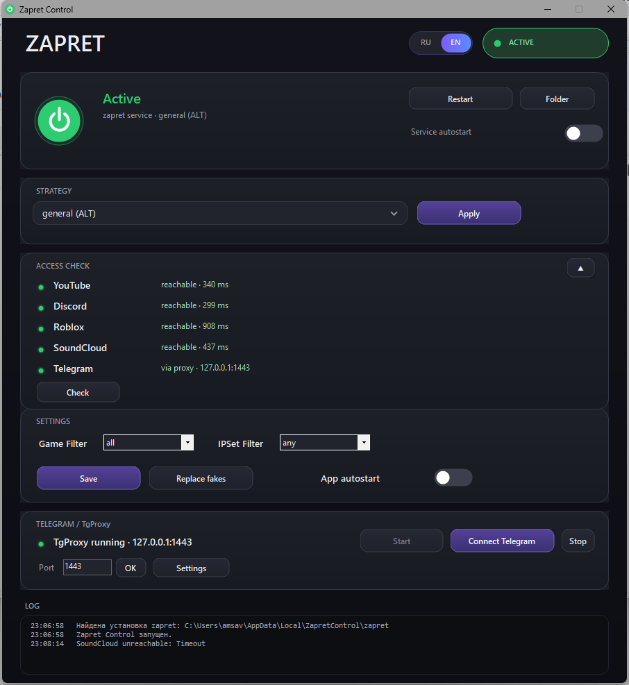

# Zapret Control

[English version](#english)

Приложение, которое помогает открыть YouTube, Discord, Roblox, SoundCloud и другие сайты, если они не работают у вашего провайдера.

- **Windows** — готовое приложение (`ZapretControl.exe`)
- **Linux** — приложение из исходников (Python/Tkinter), папка `linux-app/`
- **macOS** — приложение из исходников (Swift/AppKit), папка `macos-app/`



## Установка

### Windows
1. Скачайте `ZapretControl-windows.zip` из [Releases](../../releases) и распакуйте.
2. Запустите `ZapretControl.exe` от имени администратора.
3. Выберите стратегию и нажмите **«Применить»**. Если не заработало — попробуйте другую.

### Linux
1. Скачайте `ZapretControl-linux-src.zip` из [Releases](../../releases) и распакуйте (или возьмите папку `linux-app/`).
2. Поставьте зависимости: Python 3.8+, `python3-tk`, `git`, `curl`, `nftables`.
3. Запуск:
   ```bash
   cd linux-app
   python3 zapret_control_linux.py
   ```
   В приложении можно установить базу zapret, выбрать стратегию, управлять сервисом и TgProxy. Сборка в один файл через PyInstaller описана в `linux-app/README.md`.

### macOS
1. Скачайте `ZapretControl-macos-src.zip` из [Releases](../../releases) и распакуйте (или возьмите папку `macos-app/`).
2. На Mac (macOS 13+, Xcode Command Line Tools) соберите:
   ```bash
   cd macos-app
   chmod +x build.sh
   ./build.sh
   ```
3. Откройте `build/ZapretControl.app` (можно перенести в `/Applications`). Если macOS не даст открыть — разрешите в настройках безопасности.
4. Через меню можно поставить/запустить TgProxy и автозапуск, а для самого обхода открыть приложение Zapret для macOS и настроить стратегию/IPSet там.

Готовых бинарников для Linux и macOS в релизе нет — только исходники, их нужно собрать на своей системе. В репозитории также есть скриптовые наборы `linux/` и `macos/`.

## Что делают настройки

### Windows
- **Стратегия + «Применить»** — переключает способ обхода. Если сайт не открылся, обычно помогает другая стратегия.
- **Служба zapret** — запуск, остановка и перезапуск службы, которая делает обход.
- **Автозапуск службы** — чтобы служба поднималась вместе с Windows.
- **Проверки** — быстро показывает, открываются ли YouTube, Discord, Roblox, SoundCloud, Telegram.
- **Game Filter** — применять обход к игровому трафику: `disabled` / `tcp` / `udp` / `all`.
- **IPSet Filter** — какой список IP использовать: `loaded` / `none` / `any`.
- **Auto-Update** — автообновление частей zapret (если это поддерживает сборка).
- **Автозапуск приложения** — запускать сам Zapret Control при входе в систему.
- **Replace fakes** — обновить текущие fake/bin-файлы.
- **«Сохранить»** — сохраняет настройки (нужные параметры применяются сразу).
- **Telegram / TgProxy** — локальный прокси для Telegram Desktop: установить, запустить/остановить, выбрать порт, подключить Telegram и поменять параметры прокси (host/port, буферы, пул, cfproxy/h2/no_secure и т.п.).

### Linux
- **База zapret** — где лежит и откуда устанавливается база zapret, оттуда же берутся стратегии и управление сервисом.
- **TgProxy** — установка, запуск/остановка, порт, автозапуск (user `systemd`).
- **Автозапуск приложения** — добавляет себя в автозапуск пользователя.
- **Проверки** — простая проверка доступности сайтов.

### macOS
- **TgProxy** — установка, запуск/остановка и автозапуск (LaunchAgent).
- **Zapret для macOS** — открывает приложение для настройки стратегий, списков и IPSet.
- **Автозапуск приложения** — автозапуск через LaunchAgent.
- **Проверки** — простая проверка доступности сайтов.

## Сборка (Windows)

```bat
src\build.bat
```

## Компоненты

[NOTICE.md](NOTICE.md)

Используются: [zapret-discord-youtube](https://github.com/Flowseal/zapret-discord-youtube), [zapret-discord-youtube-linux](https://github.com/Sergeydigl3/zapret-discord-youtube-linux), [zapret-mac-discord-youtube](https://github.com/Flowseal/zapret-mac-discord-youtube), [tg-ws-proxy](https://github.com/Flowseal/tg-ws-proxy).

---

# English

Application that helps access YouTube, Discord, Roblox, SoundCloud and other sites when they don't work with your provider.

- **Windows** — ready-to-use application (`ZapretControl.exe`)
- **Linux** — application built from source (Python/Tkinter), `linux-app/`
- **macOS** — application built from source (Swift/AppKit), `macos-app/`


## Installation

### Windows
1. Download `ZapretControl-windows.zip` from [Releases](../../releases) and unpack it.
2. Run `ZapretControl.exe` as administrator.
3. Choose a strategy and click **Apply**. If it doesn't work, try another one.

### Linux
1. Download `ZapretControl-linux-src.zip` from [Releases](../../releases) and unpack it (or use the `linux-app/` folder).
2. Install the dependencies: Python 3.8+, `python3-tk`, `git`, `curl`, `nftables`.
3. Run:
   ```bash
   cd linux-app
   python3 zapret_control_linux.py
   ```
   The app lets you install the zapret base, choose a strategy, and manage the service and TgProxy. Building a single-file executable with PyInstaller is described in `linux-app/README.md`.

### macOS
1. Download `ZapretControl-macos-src.zip` from [Releases](../../releases) and unpack it (or use the `macos-app/` folder).
2. On a Mac (macOS 13+, Xcode Command Line Tools), build it:
   ```bash
   cd macos-app
   chmod +x build.sh
   ./build.sh
   ```
3. Open `build/ZapretControl.app` (you can move it to `/Applications`). If macOS blocks it, allow it in Security settings.
4. From the menu you can install/start TgProxy and enable autostart; for the bypass itself, open the Zapret app for macOS and configure the strategy/IPSet there.

There are no ready-made Linux or macOS binaries in the release — only sources that must be built on your system. The repository also contains script bundles in `linux/` and `macos/`.

## What the settings do

### Windows
- **Strategy + Apply** — switches the bypass method. If a site doesn't open, another strategy usually helps.
- **zapret service** — start, stop, and restart the service that performs the bypass.
- **Service autostart** — start the service together with Windows.
- **Checks** — quickly shows whether YouTube, Discord, Roblox, SoundCloud, and Telegram are reachable.
- **Game Filter** — apply the bypass to game traffic: `disabled` / `tcp` / `udp` / `all`.
- **IPSet Filter** — which IP list to use: `loaded` / `none` / `any`.
- **Auto-Update** — automatically update zapret components (if supported by the build).
- **App autostart** — launch Zapret Control itself when you sign in.
- **Replace fakes** — refresh the current fake/bin files.
- **Save** — saves the settings (the required parameters are applied immediately).
- **Telegram / TgProxy** — a local proxy for Telegram Desktop: install, start/stop, choose the port, connect Telegram, and change proxy parameters (host/port, buffers, pool, cfproxy/h2/no_secure, etc.).

### Linux
- **zapret base** — where the zapret base is located and installed from; strategies and service control are taken from there as well.
- **TgProxy** — install, start/stop, port, autostart (user `systemd`).
- **App autostart** — adds the app to the user's autostart.
- **Checks** — a simple site availability check.

### macOS
- **TgProxy** — install, start/stop, and autostart (LaunchAgent).
- **Zapret for macOS** — opens the app for configuring strategies, lists, and IPSet.
- **App autostart** — autostart via LaunchAgent.
- **Checks** — a simple site availability check.

## Build (Windows)

```bat
src\build.bat
```

## Components

[NOTICE.md](NOTICE.md)

Used: [zapret-discord-youtube](https://github.com/Flowseal/zapret-discord-youtube), [zapret-discord-youtube-linux](https://github.com/Sergeydigl3/zapret-discord-youtube-linux), [zapret-mac-discord-youtube](https://github.com/Flowseal/zapret-mac-discord-youtube), [tg-ws-proxy](https://github.com/Flowseal/tg-ws-proxy).
